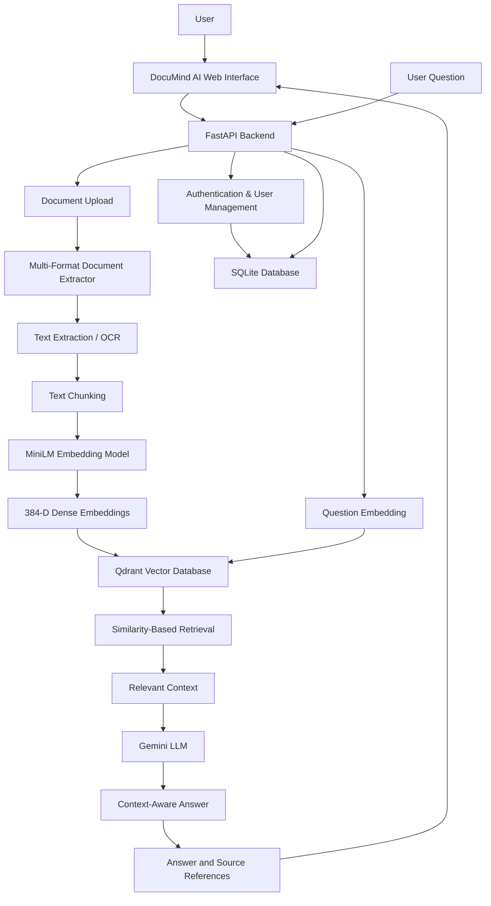

# DocuMind AI — Multi-Format AI Document Intelligence Platform

**An AI-powered document intelligence platform built with Retrieval-Augmented Generation (RAG), semantic search, and Large Language Models.**

DocuMind AI transforms static documents into searchable knowledge. Users can upload documents in multiple formats, ask natural-language questions, and receive context-aware answers supported by relevant document sources.

The project explores the complete document intelligence workflow — from multi-format extraction and embedding generation to vector retrieval, context construction, and AI-powered question answering.

---

## Project Objective

The objective of DocuMind AI is to build a practical, scalable document question-answering system that reduces the effort required to search and understand information stored across different document formats.

Instead of manually reading lengthy files, users can interact with their uploaded documents through a conversational interface. The system retrieves relevant content using semantic search and uses that context to generate answers.

The project also investigates embedding-model selection, retrieval quality, chunking strategies, and offline evaluation to understand how different design decisions affect RAG performance.

## Application Screenshots

### Landing Page


### Login Page


### Dashboard


### AI Assistant


### Dashboard Showcase


---

## Key Features

### 1. Multi-Format Document Ingestion

Upload and extract content from nine supported file extensions:

| Format | Extension |
|---|---|
| PDF documents | `.pdf` |
| Text files | `.txt` |
| JSON files | `.json` |
| Word documents | `.docx` |
| CSV files | `.csv` |
| SQL files | `.sql` |
| JPEG images | `.jpeg` |
| JPG images | `.jpg` |
| PNG images | `.png` |

- Extracts text from different document structures.
- Uses OCR to extract text from supported images.
- Processes extracted content for downstream chunking and embedding.
- Stores document metadata for retrieval and management.

### 2. Retrieval-Augmented Generation (RAG)

- Splits extracted content into manageable text chunks.
- Converts document chunks into vector embeddings.
- Retrieves relevant document content using semantic search.
- Supplies retrieved context to the language model.
- Generates answers grounded in the retrieved information.
- Provides source references alongside answers.

### 3. MiniLM Embedding Pipeline

The integrated retrieval pipeline uses:

`sentence-transformers/all-MiniLM-L6-v2`

- 384-dimensional dense embeddings.
- Normalized embeddings for cosine-similarity search.
- CPU-based embedding inference.
- Dedicated Qdrant collection: `documind_minilm_384`.
- Configured maximum sequence length of 256 tokens.
- Configured embedding batch size of 16.

### 4. Intelligent Question Answering

- Natural-language interaction with uploaded documents.
- Context-based answer generation using Gemini.
- Relevant source retrieval for answer transparency.
- General-knowledge fallback when relevant document context is unavailable.

### 5. User Authentication and Document Management

- User authentication using JWT.
- Password hashing.
- User-specific document and conversation management.
- SQLite-backed application data storage.
- Subscription-based usage limits.

### 6. Retrieval Evaluation and Experimentation

- Offline retrieval evaluation without repeated Gemini API calls.
- Precision@5, Recall@5, Mean Reciprocal Rank (MRR), and Hit Rate@5.
- Chunk-size and overlap experimentation.
- Retrieval threshold and negative-query analysis.
- Saved evaluation results for reproducibility.

### 7. CI/CD and Code Quality

- GitHub Actions-based continuous integration.
- Python compilation checks.
- Ruff linting.
- Document extraction tests.
- Docker Compose configuration validation.
- Manually triggered deployment workflow.

---

## System Architecture



## Technology Stack

| Category | Technologies |
|---|---|
| Programming Language | Python |
| Backend | FastAPI |
| Frontend | HTML, CSS, JavaScript |
| Embedding Model | Sentence Transformers — all-MiniLM-L6-v2 |
| Previous Embedding Model | BAAI/bge-m3 |
| Vector Database | Qdrant |
| Retrieval | Dense Vector Search, Similarity Search |
| LLM | Google Gemini |
| Database | SQLite, SQLAlchemy |
| Authentication | JWT, pwdlib |
| PDF Processing | PyPDF |
| Word Processing | python-docx |
| Data Processing | Pandas |
| Image Processing | Pillow |
| OCR | Tesseract, Pytesseract |
| API Documentation | Swagger UI / OpenAPI |
| Containerization | Docker, Docker Compose |
| CI/CD | GitHub Actions |
| Deployment Target | Render |

---

## Embedding Model Experimentation

An important part of DocuMind AI was exploring embedding models and their impact on document retrieval.

### Current Integrated Model: MiniLM

The current integrated retrieval path uses `sentence-transformers/all-MiniLM-L6-v2`.

| Property | Configuration |
|---|---|
| Model | `sentence-transformers/all-MiniLM-L6-v2` |
| Embedding Type | Dense |
| Vector Dimension | 384 |
| Similarity Metric | Cosine |
| Inference Device | CPU |
| Qdrant Collection | `documind_minilm_384` |
| Maximum Sequence Length | 256 |
| Batch Size | 16 |

MiniLM was integrated as a lightweight dense-retrieval option with a smaller embedding dimension and CPU inference.

### Previous Model: BGE-M3

The earlier retrieval implementation used `BAAI/bge-m3`.

| Property | Configuration |
|---|---|
| Model | `BAAI/bge-m3` |
| Embedding Type | Dense and Sparse |
| Dense Vector Dimension | 1024 |
| Qdrant Collection | `documind_bge_m3` |
| Retrieval Design | Hybrid Retrieval |
| Additional Processing | Cross-Encoder Reranking in the earlier pipeline |

The BGE-M3 implementation is retained separately as the earlier embedding and retrieval implementation. It should not be confused with the current integrated MiniLM retrieval path.

### Why MiniLM?

- Lower-dimensional embeddings than the previous BGE-M3 dense representation.
- Practical CPU-based inference.
- Suitable for experimenting with lightweight semantic retrieval.
- Dedicated vector collection keeps its embeddings separate from the earlier implementation.

---

## Retrieval Evaluation and Threshold Analysis

DocuMind AI includes an offline evaluation framework to measure retrieval quality and test how similarity thresholds affect relevant and irrelevant query handling.

The experiments use `sentence-transformers/all-MiniLM-L6-v2` with dense retrieval and require zero Gemini API calls.

### Experiment 1: Positive Retrieval Evaluation

A dataset of 10 questions was prepared across algebra and resume-document content. Each question was evaluated against manually identified relevant document chunks.

**Configuration**

| Parameter | Value |
|---|---|
| Embedding Model | `sentence-transformers/all-MiniLM-L6-v2` |
| Retrieval Method | Dense |
| Evaluation Questions | 10 |
| Retrieval Cut-off | Top 5 |
| Gemini API Calls | 0 |

**Results**

| Metric | Result |
|---|---:|
| Precision@5 | 0.20 |
| Recall@5 | 1.00 |
| Mean Reciprocal Rank (MRR) | 0.6033 |
| Hit Rate@5 | 1.00 |

These results indicate that every evaluated question retrieved its annotated relevant chunk within the top five results. However, the precision score indicates that irrelevant chunks were also present in the retrieved results.

### Experiment 2: Negative Query and Similarity Threshold Analysis

A second experiment tested the retrieval system's ability to distinguish questions related to uploaded documents from unrelated questions.

The evaluation dataset contained:

- 10 positive questions related to the uploaded documents.
- 10 negative questions unrelated to the uploaded documents.
- 5 tested similarity thresholds: 0.20, 0.25, 0.30, 0.35, and 0.40.

**Threshold Evaluation Results**

| Threshold | True Positives | False Negatives | True Negatives | False Positives | Balanced Accuracy |
|---:|---:|---:|---:|---:|---:|
| 0.20 | 9 | 1 | 10 | 0 | 95% |
| 0.25 | 9 | 1 | 10 | 0 | 95% |
| 0.30 | 9 | 1 | 10 | 0 | 95% |
| 0.35 | 8 | 2 | 10 | 0 | 90% |
| 0.40 | 7 | 3 | 10 | 0 | 85% |

**Best observed threshold range: 0.20–0.30**

At these thresholds, the experiment achieved:

- 90% positive-query acceptance.
- 100% negative-query rejection.
- 0% false acceptance rate.
- 95% balanced accuracy.

Increasing the threshold beyond 0.30 reduced the acceptance of relevant questions without improving negative-query rejection in this dataset.


### Evaluation Metrics and Interpretation

The following metrics were used to evaluate the MiniLM dense-retrieval pipeline.

| Metric | Description | Observed Result |
|---|---|---:|
| Precision@5 | Proportion of retrieved top-five chunks that are relevant | 0.20 |
| Recall@5 | Proportion of annotated relevant chunks retrieved within the top five | 1.00 |
| Mean Reciprocal Rank (MRR) | Average reciprocal rank of the first relevant result | 0.6033 |
| Hit Rate@5 | Proportion of questions with at least one relevant result in the top five | 1.00 |

**Interpretation of Results**

- **Precision@5 — 0.20:** On average, 20% of the retrieved chunks in the top five were relevant according to the evaluation annotations.
- **Recall@5 — 1.00:** All annotated relevant chunks were retrieved within the top five results.
- **MRR — 0.6033:** The first relevant result appeared relatively high in the ranking on average, although its position varied across questions.
- **Hit Rate@5 — 1.00:** Every evaluated positive question had at least one relevant chunk within the top five results.

**Threshold Analysis Metrics**

| Metric | Description |
|---|---|
| True Positive (TP) | Relevant query correctly accepted |
| False Negative (FN) | Relevant query incorrectly rejected |
| True Negative (TN) | Unrelated query correctly rejected |
| False Positive (FP) | Unrelated query incorrectly accepted |
| Balanced Accuracy | Average of positive-class recall and negative-class recall |

**Threshold Experiment Interpretation**

At thresholds 0.20, 0.25, and 0.30, the experiment achieved:

- 90% positive-query acceptance.
- 100% negative-query rejection.
- 0% false acceptance rate.
- 95% balanced accuracy.

These results indicate that similarity-based filtering can help distinguish relevant and unrelated queries within the prepared evaluation dataset.


### Evaluation Files

The evaluation and experiment files are maintained under:

```text
app/evaluation/
├── evaluate_minilm.py
├── experiment_chunking.py
├── minilm_dataset.json
├── minilm_evaluation_results.json
├── minilm_negative_dataset.json
└── minilm_threshold_analysis.json
```

## Project Structure

```text
DocuMind-AI/
│
├── app/
│   ├── main.py
│   │
│   ├── rag/
│   │   ├── document_extractor.py
│   │   ├── ...
│   │
│   ├── evaluation/
│   │   ├── evaluate_minilm.py
│   │   ├── experiment_chunking.py
│   │   ├── minilm_dataset.json
│   │   ├── minilm_evaluation_results.json
│   │   ├── minilm_negative_dataset.json
│   │   └── minilm_threshold_analysis.json
│   │
│   └── tests/
│       ├── test_document_extractor.py
│       └── sample_documents/
│
├── frontend/
│   ├── index.html
│   ├── app.js
│   └── style.css
│
├── assets/
│   └── application screenshots
│
├── data/
│   └── documind.db
│
├── .github/
│   └── workflows/
│       └── ci-cd.yml
│
├── docker-compose.yml
├── requirements.txt
├── pyproject.toml
└── README.md
```

*The tree above highlights the main project components; individual implementation files may vary as the project evolves.*

---

## Installation and Setup

### Prerequisites

Make sure the following tools are installed:

- Python 3.10 or later.
- Git.
- Docker Desktop with Docker Compose.
- Tesseract OCR for image text extraction.

### 1. Clone the Repository

```bash
git clone https://github.com/Vaiishnavi-1350/DocuMind-AI.git
cd DocuMind-AI
```

### 2. Create a Virtual Environment

**Windows PowerShell:**

```powershell
python -m venv venv
.\venv\Scripts\Activate.ps1
```

**Linux / GitHub Codespaces:**

```bash
python3 -m venv venv
source venv/bin/activate
```

### 3. Install Dependencies

```bash
python -m pip install --upgrade pip
pip install -r requirements.txt
```

### 4. Configure Environment Variables

Configure the API credentials and application settings required by the backend.

At minimum, provide a valid Google Gemini API key and a secure application secret through the environment configuration expected by the application.

Do not commit API keys, passwords, database credentials, or other secrets to GitHub.

### 5. Start Qdrant

Start the Qdrant service using Docker Compose:

```bash
docker compose up -d
```

Verify that the Qdrant service is running before starting the backend.

### 6. Run the FastAPI Backend

```bash
uvicorn app.main:app --reload
```

Open the API documentation in your browser:

```text
http://127.0.0.1:8000/docs
```

### 7. Open the Frontend

Open the frontend entry point:

```text
frontend/index.html
```

Use the application interface to register or log in, upload documents, and ask questions.

---

## Testing and Code Quality

Run the document extraction test suite:

```bash
python -m app.tests.test_document_extractor
```

The test suite covers the supported document extraction formats, including image OCR.

Run Ruff checks:

```bash
ruff check app
```

Compile the application modules:

```bash
python -m compileall -q app
```

Validate the Docker Compose configuration:

```bash
docker compose config -q
```

---

## CI/CD Pipeline

DocuMind AI uses GitHub Actions to automate code-quality and validation checks.

The CI workflow includes:

1. Checking out the repository.
2. Setting up Python.
3. Installing project dependencies.
4. Running Ruff lint checks.
5. Running document extraction tests.
6. Compiling Python application modules.
7. Validating the Docker Compose configuration.

The MiniLM migration was merged into the `master` branch through a pull request after the CI checks passed.

### Deployment Strategy

A manually triggered deployment workflow is prepared using GitHub Actions and a Render Deploy Hook.

Automatic Render deployment is disabled. The updated MiniLM version has not been promoted to the Render production deployment because the available Render Free instance has a 512 MB RAM constraint, which may be insufficient for reliable model loading and inference.

Deployment will require resource and runtime validation before production release.

---

## Security and Reliability

- JWT-based authentication.
- Password hashing.
- Environment-based secret configuration.
- User-specific application data.
- Document metadata management.
- Separate Qdrant collections for the MiniLM and earlier BGE-M3 implementations.
- Retrieval evaluation without unnecessary LLM API calls.

---

## Current Project Status

| Component | Status |
|---|---|
| FastAPI Backend | Implemented |
| Web Frontend | Implemented |
| User Authentication | Implemented |
| Multi-Format Ingestion | Implemented |
| OCR-Based Image Extraction | Implemented |
| RAG Question Answering | Implemented |
| Qdrant Integration | Implemented |
| MiniLM Embedding Migration | Merged into `master` |
| Previous BGE-M3 Implementation | Retained separately |
| Offline Retrieval Evaluation | Implemented |
| Document Extraction Tests | Passing |
| GitHub Actions CI | Passing |
| Manual Deployment Workflow | Prepared |
| Updated MiniLM Production Deployment | Pending resource validation |

---

## Future Improvements

- Improve retrieval precision through chunking and retrieval-parameter optimization.
- Expand the evaluation dataset with more document types and question categories.
- Compare additional lightweight embedding models.
- Add answer-quality evaluation and groundedness checks.
- Improve support for large documents and complex tables.
- Optimize memory consumption for production deployment.
- Add monitoring, logging, and performance analytics.
- Expand automated integration and end-to-end testing.

---

## Skills Demonstrated

This project demonstrates practical experience with:

- Python application development.
- Generative AI and Large Language Models.
- Retrieval-Augmented Generation (RAG).
- Semantic search and vector databases.
- Sentence Transformers and embedding models.
- Document processing and OCR.
- FastAPI backend development.
- Database integration and authentication.
- Offline model and retrieval evaluation.
- Git, GitHub, and pull-request workflows.
- CI/CD automation using GitHub Actions.
- Docker-based service management.

---

## Author

**Vaishnavi Jadhav**

Computer Science and Engineering — Artificial Intelligence Analytics

GitHub: [Vaiishnavi-1350](https://github.com/Vaiishnavi-1350)

Project Repository: [DocuMind AI](https://github.com/Vaiishnavi-1350/DocuMind-AI)

## License

No open-source license has been specified yet. All rights remain with the project author unless a license is added to the repository.
